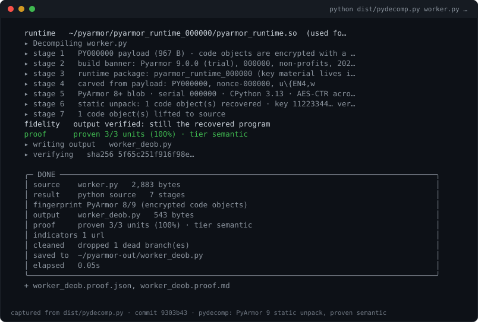
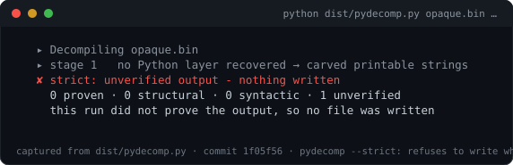
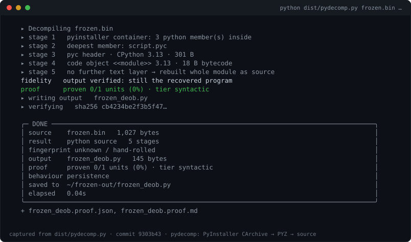

# pydecomp

**Python deobfuscator and decompiler.** Unpacks PyArmor 8/9, PyInstaller,
Nuitka, cx_Freeze, py2exe, PEX, shiv, briefcase, Cython, marshal, `.pyc`
1.0–3.15, and Base64/zlib/XOR/emoji chains — statically, on your machine.

**Every output ships with a machine-checkable proof. pydecomp refuses to write
source at the tier it proves.**  By [Idam Emmanuel](https://github.com/idam001).

[](https://github.com/idam001/pydecomp/actions/workflows/ci.yml)


```
sample_deob.py          the recovered program
sample_deob.proof.json  what was peeled, which backend decompiled it,
                        which functions are instruction-identical, and what
                        was inferred or lost
```

```
$ pydecomp suspicious.py
   ▸ Decompiling suspicious.py
   ▸ stage 1   layer 1: base64 → zlib · 1,204 B
   ▸ stage 2   layer 2: marshal → code object · 12,884 B
   ▸ writing output   suspicious_deob.py
   ▸ verifying   sha256 9f2c1ab0…

   ╭─ DONE ─────────────────────────────────────────────────────────────╮
   │ source    suspicious.py   2,499 bytes                              │
   │ result    lifted from bytecode   3 stages                          │
   │ output    suspicious_deob.py   5,386 bytes                         │
   │ elapsed   0.03s                                                    │
   ╰────────────────────────────────────────────────────────────────────╯
```

One source file out, with its proof beside it. No telemetry, no `exec`, and no
network unless you ask for it (`--fetch-iocs`).

Every recovered file carries exactly one line above the code, and nothing else:

```python
#[ Deobfuscated by idam Emmanuel ] only through pydecomp
```

---

## What the proof says

Every run grades the recovered program against the code it came from, unit by
unit, and writes the result next to the output:

| tier | meaning | written as |
|---|---|---|
| **semantic** | recompiles to the *same instruction stream* as the original | plain source |
| **structural** | same control-flow shape and constant table, encoding differs | `--annotate` marks it |
| **syntactic** | it compiles; equivalence not proven | `--annotate` marks it |
| **unverified** | it does not compile; kept because dropping it loses code | `--annotate` marks it |



```console
$ pydecomp worker.py          # a real PyArmor 9 payload, runtime beside it
   runtime   ~/case/pyarmor_runtime_000000/pyarmor_runtime.so  (used for the runtime key)
   ▸ stage 5   PyArmor 8+ blob · serial 000000 · CPython 3.13 · AES-CTR across the code objects
   ▸ stage 6   static unpack: 1 code object(s) recovered · key 11223344… verified by marshal structure
   fidelity   output verified: still the recovered program
   proof      proven 3/3 units (100%) · tier semantic
```

`--strict` writes **nothing** unless every unit is instruction-identical, and
exits `3`. It is the only Python recovery tool that will refuse its own output.



### Verify a proof yourself

A proof is only worth something if somebody else can check it. One flag
re-derives it from the sample and the file that was written:

```console
$ pydecomp --check-proof out/worker_deob.proof.json
   proof  worker_deob.proof.json
     ok   schema           all keys present
     ok   guarantee        no input byte was executed, imported, or compiled
     ok   input sha256     recorded 58c1b15b93f2c34b… / now 58c1b15b93f2c34b…
     ok   output sha256    ~/out/worker_deob.py
     ok   tiers reproduce  recomputed semantic=3, structural=0, syntactic=0
   verified: this file is what the proof says it is
```

Change one line of the output and the same command exits `4` with
`DRIFT: the proof no longer describes these files`. `--html` writes a
self-contained `.report.html` (source, proof, indicators, guarantee) that opens
offline — no CDN, no fonts, no scripts.



## What it handles

| | |
|---|---|
| **Protectors** | PyArmor 8/9 **static unpack** (header parse → key hunt in `pyarmor_runtime` → AES-CTR → marshal → lift, key accepted only when the plaintext parses), PyArmor 7 static carve (key fragments reported), Hyperion, pyobfuscate.com |
| **Freezers** | PyInstaller CArchive + PYZ (2.0 and 2.1+ cookies, stripped `.pyc` headers rebuilt), cx_Freeze, py2exe, PEX, shiv, briefcase |
| **Bytecode** | CPython 3.8–3.15 by table, `.pyc` 1.0–3.15 sniffed, PyPy lifted with the closest table (marked *approximate*) |
| **Interpreters** | CPython, PyPy, MicroPython `.mpy`, Jython, IronPython, Brython — named by signature, never guessed |
| **Obfuscators** | 21 named schemes with their contract (marker or shape), then the generic peeler |
| **Backends** | the bundled lifter, plus `pycdc-rs`, `pycdc`, `depyo`, `uncompyle6`, `decompyle3` when installed — chosen by proof tier, not by order |
| **Agents** | MCP server (`pydecomp --mcp`): `identify`, `peel`, `triage`, `decompile_pyc`, `deobfuscate` |
| **Plugins** | `pip install`able decoders via the `pydecomp.decoders` entry point |

## The board

Running `pydecomp` with no arguments shows the banner: the block logo, the
author's welcome band, the network and country of the machine doing the
analysis (read offline — no sockets, no DNS), and the identity card.

```
   ꧁✿❀✿꧂─────────────────────────────────────────────────────────────꧁✿❀✿꧂

   ████  █   █ ████  █████  ████  ███  █   █ ████
   █   █ █   █ █   █ █     █     █   █ ██ ██ █   █
   ████   ███  █   █ ████  █     █   █ █ █ █ ████
   █       █   █   █ █     █     █   █ █   █ █
   █       █   ████  █████  ████  ███  █   █ █

   ꧁✿❀✿꧂─────────────────────────────────────────────────────────────꧁✿❀✿꧂
                    WELCOME TO IDAM EMMANUEL TOOLS

   [ NETWORK ] : WLAN0, RMNET_DATA0
   [ COUNTRY ] : Nigeria
   ═══════════════════════════════════════════════════════════════════════
   [•] Owner   : [Idam Emmanuel]
   [•] Tool    : [PYDECOMP]
   [•] Edition : [THE ALMIGHTY]
   [•] Status  : [OPEN SOURCE]
   [•] Version : [1.0.0]
   ═══════════════════════════════════════════════════════════════════════
```

`--no-color` or a pipe prints the same board as plain text. Override the
detected values with `PYDECOMP_NETWORK` / `PYDECOMP_COUNTRY`, and rebrand a fork
with `PYDECOMP_AUTHOR` / `PYDECOMP_SIGNATURE`.

---

## Named packers it reconstructs

| Container | What pydecomp does, statically |
| --- | --- |
| base64 / zlib / bz2 / lzma / hex / base85 / z85 / base58 / base45 / base91 / uu chains | peels 64 layers, 12 chains |
| marshal / `.pyc` (`3.9 → 3.14`) | own marshal reader + lifter |
| PyInstaller (CArchive + PYZ) | cookie → TOC → entries → PYZ → modules |
| Cython `.so` / ELF payloads | tier-S exact / structural |
| PyArmor 8–9 | bootstrap + build banner + carved payload strings, with an honest "the code objects stay encrypted" |
| Hyperion | recovers the `__code__` program |
| pyobfuscate.com (paid tier) | base85 → PBKDF2-SHA256 ×1e6 → AES-GCM, decrypted offline |
| string tables + rotation | rotation replayed, accessors resolved, decoders folded |
| MBA / opaque predicates / CFF / unicode aliases / dynamic builtins | rewritten to plain Python |

## Why this exists

Most "deobfuscators" are either a pile of regexes for one family, or a wrapper
that `exec`s the sample inside a container and hopes for the best. pydecomp takes
the third road: it **models the bytecode**. It parses the sample as text, walks
`marshal` images with its own reader, disassembles and lifts opcodes up to
statements, folds constants, evaluates pure expressions in a private namespace,
and demangles the naming schemes the popular obfuscators emit. Nothing from the
sample is ever imported or executed — the only `exec` in the codebase loads
pydecomp's own native sidecar.

The result is a tool that behaves the same on your laptop, in CI, in a Docker
container and on a phone: one directory tree, or one file.

## Highlights

| | |
|---|---|
| **Static only** | The sample is data. No `exec`, no `eval`, no subprocess, no import. |
| **Layered** | 25 nesting layers, 32 MiB per layer, cycle-safe. |
| **Both engines** | Text/expression engine for source-level obfuscation, bytecode engine for `marshal`/`pyc`/`compile()` payloads. |
| **Version-aware** | Own `marshal` reader and opcode tables for CPython 3.9 → 3.14, without needing that interpreter installed. |
| **Runs anywhere** | Pure standard library, single file if you want it, Termux included. |
| **Honest output** | Every recovery is compiled, audited for unbound names, and reported — a file that would not run is caught before it is written. |

## Cleaning may never cost you the program

The last thing that happens before a file is written is a fidelity check: the
cleaned source is compared with the program as it came out of the container.  It
is kept only if it still parses, still holds its definitions, and is not a wall
of literals.  If an upgrade would degrade the result, the unpacked program is
written instead and the tool says so:

```
   fidelity   rolled back to the unpacked program — cleaning lost 3 of 4 definition(s)
```

You lose a little tidiness, never the recovered script.

## Install

```console
$ pip install pydecomp-tool      # the command is still `pydecomp`
$ pip install "pydecomp-tool[backends]"   # + pycdc-rs / depyo if you have them
```

**Q: is this the `pydecomp` on PyPI?** No — that is an unrelated project. This
repo installs as `pydecomp-tool` (or `pip install
git+https://github.com/idam001/pydecomp.git`); the module and the command are
`pydecomp`.

## Install (from a checkout)

> The PyPI name `pydecomp` is taken by an **unrelated** project, so
> `pip install pydecomp` gives you the wrong tool. Install from Git:

```bash
pip install "git+https://github.com/idam001/pydecomp.git"
pipx install "git+https://github.com/idam001/pydecomp.git"   # isolated CLI
```

From a checkout:

```bash
git clone https://github.com/idam001/pydecomp.git
cd pydecomp
pip install -e ".[dev]"
```

**No pip at all?** Build the single file and copy it anywhere:

```bash
python3 tools/build_single.py           # -> dist/pydecomp.py (~273 KB)
scp dist/pydecomp.py phone:/sdcard/     # Termux guide: docs/termux.md
```

Requires CPython 3.9 or newer. Nothing else. The single-file build carries the
whole package — including the native/ELF sidecar — inside one compressed blob.

## Quick start

```bash
pydecomp sample.py                       # recover next to the input
pydecomp sample.py -o out/               # choose the output folder
pydecomp sample.py --reports             # also write .report.json and .report.md
pydecomp sample.py --no-anim --no-color  # plain text for CI
pydecomp --selftest                      # check the install
```

Interactive menu (no arguments):

```bash
$ pydecomp
  [1]  deobfuscate a script       peel every layer  ·  save one file
  [2]  Cython module (.so)        rebuild the source from a compiled module
  [3]  ELF binary                 hunt for Python payloads inside a binary
```

Python API:

```python
import pydecomp

result = pydecomp.dig(open("sample.py", "rb").read(), "sample.py")
print(result.text)          # recovered source
print(result.stages)        # [Stage(1, "base64", "zlib", 1204), ...]

pydecomp.peel("sample.py", out_dir="out")   # CLI-equivalent, returns paths
```

## What it recovers

The engine is a pipeline, and every stage reports what it did:

1. **Sniff** — text, `marshal` image, `pyc`, zip, or ELF.
2. **Unwrap** — base64 / base85 / base32 / hex / emoji / raw-zlib / gzip /
   bz2 / lzma / zip, recursively, in any order, up to 25 layers.
3. **Decompile** — `marshal` → code object → opcode walk → AST → source, with
   a table of opcodes for the *declared* version, not the running one.
4. **Fold & evaluate** — constant folding, dead-branch removal, and a pure
   expression evaluator with a whitelist (no I/O, no imports outside the
   whitelist) for decoder chains like `''.join(chr(...))`.
5. **Polish** — demangle `lIIllIlI`-style identifiers, undo control-flow
   flattening, and stamp the result with the project signature.
6. **Audit** — compile the result, list unresolved names, keep `_PydecompUnknown`
   where the value is not in the bytecode, `_PydecompUnknown` names the hole.

## Measured results

Run on this checkout (`python3 tools/run_gates.py`), CPython 3.13, Linux x86-64 —
30 gates, plus 280 unit tests:

| Gate | Result |
|---|---|
| `test_v4` — classic packing cases | 20/20 |
| `test_v5` — CLI, output layout, static-only | 26/26 |
| `test_v6` — policy chatter, fallbacks, round trip | all good |
| `test_v7` — menu and prompts | all good |
| `test_v8` — polish, folding, demangling | 44/44 |
| `test_identity` — instruction-identical round trips | 47/47 |
| `test_probes` — obfuscator shapes | 37/37 |
| `test_native` — Cython/ELF recovery | 41/41 |
| `test_proof` — proof schema, `--strict` exit codes | all good |
| `test_pyarmor` — PyArmor 8/9 static unpack, CLI | all good |
| `test_freezers` — six freezers + PyInstaller PYZ | all good |
| `test_agents` — MCP handshake/tools, plugins, cross-impl | all good |
| `obf_bench` — hardest-obfuscation suite | 33/44 semantic · 11/11 rebuilt as source |
| `bench_core` — peel/decompile/AES budgets | 3/3 budgets met |
| `examples` — the six worked examples | 6/6 recovered |
| `corpus` — 50 families × 4 payloads | 200/200 recovered |
| `learn` — trained decoder ranking | 37.5% → 75.0% top-1, 7.81 → 1.62 decodes |
| `stress` — 200 random stacks, up to 24 layers, 18 codecs, 13 loader shapes | 200/200 recovered (floor 196) |

Real samples (byte-for-byte stable across releases):

| Sample | Input | Output | Time |
|---|---|---|---|
| `All-nasa-hacker.py` | 2,499 B | 5,386 B | 0.03 s |
| `Kamrul.py` | 647,813 B | 42,246 B | 0.47 s |
| `Old.py` | 1,136,184 B | 723,362 B | 3.55 s |

## The corpus is the data centre

No claim in this README rests on a screenshot of one lucky file.  `corpus/` holds
**50 families × 4 real payload programs = 200 cases**, generated by
`tools/make_corpus.py`, each with a `truth.json` that names the payload by digest:

```
a_b64  b_b64_twice  c_zlib_b64  d_b64_zlib  e_lzma_b64  f_gzip_b64  g_bz2_b64
h_b32_b64  i_b85  j_a85  k_b64url  l_hex  m_escaped  n_xor_b64  o_reverse_b64
p_rot13_b64  q_mix_three  r_mix_four  s_chr_array  t_zip_member  u_marshal_b64
v_pyc_b64  w_bare_marshal  x_marshal_zlib  y_pyc_zlib_b64  z_refuse
aa_base58  ab_base62  ac_base45  ad_z85  ae_uu  af_hex_upper  ag_double_zip
ah_eval_chain  ai_stacked_mixed  aj_string_table  ak_inline_import
al_lambda_indirect  am_lambda_reverse  an_nested_exec  ao_zero_width
ap_exec_compile  aq_b85_zlib_marshal  ar_deep_twelve  as_string_array  at_chr_arith
```

`tools/eval_corpus.py` runs the analyser over every case and grades the file it
wrote against the payload: it has to compile **and** keep ≥90% of the payload's
behaviour-bearing tokens (names, string *values*, numbers).  Latest run, this
checkout:

| | cases | recovered | mean token recall | time |
|---|---|---|---|---|
| all families | 200 | **200** | 98.0% | 3.86 s |

The per-family table is [docs/corpus-results.md](docs/corpus-results.md). Beyond the
named families, `tools/stress_corpus.py` builds **random stacks nobody wrote
down** from the same layer table and grades them the same way. The gate runs
**200 stacks over five seeds, up to twenty-four layers deep**, drawn from all
eighteen reversible codecs the families use — including base58, base62, base45
and z85, whose loaders are counting loops rather than one-line calls, so the
harness generates the same loop a real loader spells out. Each loader is also
dressed in one of thirteen shapes an obfuscator actually ships: bare, inside a
`def`, inside a class method called through an instance, behind a decoy `exec`,
behind `getattr(__import__('builtins'), 'exec')`, behind a dict-dispatch table,
inside a `while True:` driver, behind three hidden spellings of `exec`
(`_b.exec`, a split `getattr`, `sys.modules['builtins']`), and with the loader
*itself* stored as string
chunks or as reversed lines joined at runtime. Latest run: **200/200
recovered**, floor **196**, mean depth 8.0 — and 100/100 on seeds 6 and 7,
which the gate never sees. A case that used to be recovered and stops being
recovered fails the `corpus` gate, so the number can only go up with the code,
never down with the prose.

Five things the corpus forced out of the engine, because a family failed and
the gate would not let it slide:

- **`marshal.loads(_p)` is a payload sink.** A packer that ships a marshalled
  code object rarely calls `exec()` on a literal; it loads it into a name. The
  sink scan now knows the code-loader calls too, and reads the bytes with the
  static marshal reader — 20 more cases recovered.
- **base45 and z85 were wrong.** RFC 9285 puts the high byte of a triple first;
  the decoder read it second, so every base45 payload came out byte-swapped and
  `8U-R3` raised instead of returning `Hello!!`. z85 ran its input through the
  separator stripper, and Z85's alphabet *contains* `.`, `-`, `:`, `+`, `=`, so
  the strip destroyed the encoding. Both fixed against published vectors, with
  `tests/unit/test_codec_vectors.py` holding them down.
- **Loaders are sloppy about base64, and the evaluator refused all three ways.**
  They use the url-safe alphabet and call the plain decoder, call the url-safe
  decoder on plain text, and strip the `=` padding to fit the blob on one line.
  Each one ended a chain that could have been finished; the evaluator now accepts
  the right alphabet either way and restores padding. That alone took the random
  stack run from 85/100 to 97/100.
- **A nested stack is followed to the bottom.** `an_nested_exec` is the
  TrustedSec bytecode stack: a loader inside a marshalled code object, which was
  itself marshalled, three deep. Lifting one level and stopping hands the operator
  stage two and calls it the program. A lifted module that is itself a loader is
  now followed down until the text stops being a loader.
- **A decoded payload that is not Python must not be re-emitted as `exec(b'…')`.**
  Folding a decode into an exec sink produced a file that ran garbage and never
  existed. A refusal now leaves the file as written; the `z_refuse` family holds
  that behaviour in place.

## Learned priors

An unknown blob could start with any of 22 decoders. Trying them in table order
is a guess. `pydecomp.learn` ranks them from features of the bytes alone (size,
entropy, alphabet membership, container magic, quadratic tells), trained on the
corpus by `tools/train_learn.py` — an averaged perceptron in plain Python,
weights committed as integers in `src/pydecomp/learn/weights.py`.

Measured with a **payload held out of training** (`text` never seen), so the
number is generalisation, not memory:

| order | top-1 decoder | decodes before the right one |
|---|---|---|
| registry order | 37.5% | 7.81 |
| learned | **75.0%** | **1.62** |

The ranking is only an *order*: every decoder is still tried, so a wrong guess
costs a decode and never a payload. `learn` gate re-trains from the corpus and
fails if the committed weights stop beating table order, or if the corpus moved
out from under them.

## Where the corpus goes next

Every case that defeats the tool becomes a family. That is the whole method: a
failure is a test, not a paragraph.
## Configuration

| Variable | Meaning |
|---|---|
| `PYDECOMP_MAX_BYTES` | Size ceiling for one layer (default 32 MiB). |
| `PYDECOMP_MAX_LAYERS` | Nesting ceiling (default 25). |
| `NO_COLOR` | Same as `--no-color`. |

No config files, no cache directory, no state. Everything lives in
`src/pydecomp/limits.py`.

## Project layout

```
src/pydecomp/          engine (75 modules + 15 package inits, ~14.2k lines)
  engine/            dig, digest, follow-the-source pipeline
  decoders/          base64/85/32, hex, emoji, zip, compression
  crypto/            stdlib-only RC4, XOR, Blowfish, AES helpers
  eval/              pure expression evaluator + namespace + whitelist
  bytecode/          marshal reader, disassembler, opcodes, lifters, decompiler6
  lift/              module-level rebuild, import repair, hoisting
  polish/            demangle, dead code, folding, control-flow unflattening
  triage/            fingerprints, behaviour hints, risk indicators
  output/            writer, report renderer, signature
  terminal/          banner, panels, colour, animation, menu
  native/            Cython/ELF sidecar (option 2/3 front-end)
tests/               unit, integration gates, benchmarks, fixtures
tools/               build_single, run_gates, gen_opcode_tables, fixtures, release
docs/                mkdocs site (13 pages)
examples/            runnable examples and their expected output
```

## Contributing

Issues with a *sample* are the most useful contribution — see
[CONTRIBUTING.md](CONTRIBUTING.md) and the "new sample" issue template. Please
do not paste live malware; use a hash plus a redacted or defanged snippet.

- [Code of Conduct](CODE_OF_CONDUCT.md)
- [Governance](GOVERNANCE.md)
- [Security policy](SECURITY.md) — for vulnerabilities *in pydecomp*
- [Changelog](CHANGELOG.md)
- [Documentation](docs/index.md)

## Legal

pydecomp is a defensive and research tool. Use it on files you own or are
authorised to analyse. The authors do not accept liability for misuse. The
tool never executes the sample; what you do with the recovered code is your
responsibility.

MIT licensed, © 2026 Idam Emmanuel — see [LICENSE](LICENSE).
